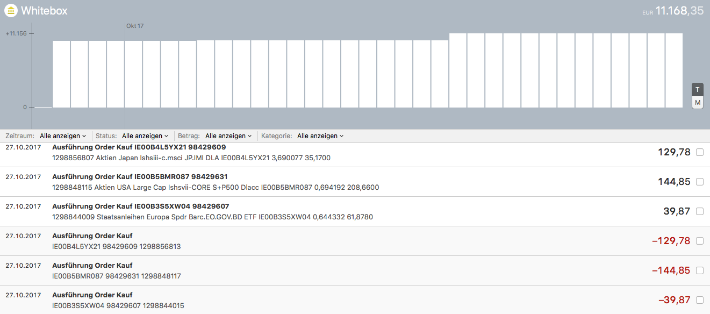
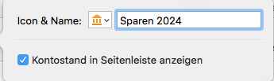
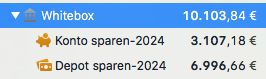

# moneymoney-whitebox
An Extension to query your Whitebox.eu goals in [MoneyMoney](https://moneymoney-app.com).

## Herkunft und KI-Reparatur

Dieses Projekt ist ein Fork von
[mirkowein/moneymoney-whitebox](https://github.com/mirkowein/moneymoney-whitebox).
Die ursprüngliche Erweiterung stammt von
**[Mirko Weinschenk (mirkowein)](https://github.com/mirkowein)**.
Die MIT-Lizenz und die ursprünglichen Copyright-Hinweise bleiben erhalten.

Diese Fassung wurde durch KI unter Anleitung von
[DWegmann](https://github.com/DWegmann) repariert und an die neue Whitebox-Oberfläche
angepasst. Nach deren Umstellung funktionierte die Anmeldung weiterhin, die bisherige
Kontensuche anhand der HTML-Seite jedoch nicht mehr. Die Reparatur ist in Version
**1.16** zusammengefasst.

### Unterschiede zum Original

- **Datenzugriff:** Kontensuche, Bestände, Umsätze und Performance werden über
  GraphQL statt über die bisherigen HTML-/REST-Abfragen geladen. Die Anmeldung
  nutzt weiterhin das vorhandene Login-Formular.
- **Buchungsbeträge und Texte:** Depotumsätze übernehmen den von Whitebox
  gelieferten Betrag mit Vorzeichen statt einer Berechnung aus Stückzahl und Kurs.
  Cash-Ordertitel und Referenznummern werden getrennt aufbereitet; Anlageklassen
  werden über zusätzliche Depotmetadaten zugeordnet, soweit verfügbar.
- **Abweichende Datenverfügbarkeit:** Die neue Umsatzabfrage liefert keinen
  historischen Ausführungskurs und kein gesondertes Wertstellungsdatum.
  Depotbuchungstexte zeigen deshalb einen aus Betrag und Stückzahl berechneten
  Näherungswert als `Kurs ca.`; das Wertstellungsdatum wird nicht ergänzt.
- **Fehlerprüfung:** Fehlende Pflichtdaten, ungültige Werte und GraphQL-Fehler
  brechen den Abruf ab, statt unvollständige Daten als leere Bestände zu übernehmen.
- **Tests und Dokumentation:** Ergänzt wurden Offline-Tests mit künstlichen Daten,
  Referenzabfragen und eine [Implementierungsdokumentation](IMPLEMENTATION.md).
  Die Tests ersetzen keine vollständige Prüfung mit einem echten Konto.
- **Signatur:** Die reparierte Version ist unsigniert und benötigt für die reguläre
  Veröffentlichung eine neue Signatur durch MoneyMoney.

Die vier Kontoansichten `KONTO`, `DEPOT`, `PORTFOLIO` und `PERFORMANCE` bleiben
erhalten. Bestehende Konten bleiben zuordenbar, wenn ihre bisherige Kennung dem
vollständigen Whitebox-`slug` entspricht. Einzelheiten zur Installation und zu den
technischen Grenzen stehen weiter unten.



Es werden jeweils 4 Accounts für jedes aktive Ziel angelegt:
- KONTO = Umsätze Cash
- DEPOT = Umsätze im Depot
- PORTFOLIO = Bestand ETF 
- PERFORMANCE = Nur Informationen: Erfolgsrelevante Kapitalveränderungen, Geldgewichtete Rendite annualisiert, Geldgewichtete Rendite, Vermögensstand

Es macht Sinn als Kontogruppe zu gruppieren. Also KONTO und DEPOT hat in der Summe den Vermögensstand. Oder KONTO und PORTFOLIO.
Es macht keinen Sinn DEPOT und PORTFOLIO zu haben. Sie sind 2 Darstellungen des selben Vermögens. Die Summe wäre dann doppelt in Ihren Übersichten. 

Kurz:
- KONTO + DEPOT oder
- KONTO + PORTFOLIO
- PERFORMANCE optional dazu.

## Tipp: 
Zusammen als **Kontogruppe** mit *"Kontostand in Saldenleiste anzeigen"* zusammenfassen, dann hat man den Gesamtwert des Ziels 




## Neue Whitebox-Oberfläche (Version 1.16)

Die Erweiterung nutzt die GraphQL-Schnittstelle der neuen Whitebox-Oberfläche.
Die Anmeldung erfolgt weiterhin über das vorhandene Login-Formular; anschließend
wird die Sitzung über `/api/onboarding/session` für die Datenabfragen verwendet.

Die Kontensuche findet aktive Anlagen mit zugeordnetem Depot. Sie übernimmt den
vollständigen `slug` der Anlage einschließlich eventueller Suffixe und verwendet
für die Datenabfragen die von Whitebox gelieferten Anlagen- und Depotkennungen.
Bestehende Konten bleiben zuordenbar, wenn ihre bisherige Kennung diesem `slug`
entspricht. Andere Kundenbereiche als der nach der Anmeldung ausgewählte werden
nicht automatisch zusammengeführt.

Cash- und Depotumsätze übernehmen den von Whitebox gelieferten Buchungsbetrag
mit Vorzeichen. Fehlende Pflichtdaten oder GraphQL-Fehler brechen den Abruf ab,
statt als leere Bestände importiert zu werden. Die neue Umsatzabfrage liefert nur
ein Buchungsdatum; ein gesondertes Wertstellungsdatum wird nicht ergänzt.
Noch nicht verfügbare Renditen werden als „nicht verfügbar“ angezeigt.
Die monetäre Performance-Zeile behält ihre bisherige Bezeichnung
„Erfolgsrelevante Kapitalveränderungen“ und die Kennung
`Performance sum_of_erfolgsrelevante_kapitalveraenderungen`. Ihr Betrag stammt
aus dem aktuellen API-Feld `returnInEuro`.
Die Zeitangabe von Wertpapierpositionen entspricht wie bisher dem Abrufzeitpunkt.

Wertpapiernamen enthalten wieder die Whitebox-Anlageklasse in Klammern, zum Beispiel
`AMUNDI IS MSCI EMERGING M (Aktien Schwellenländer)`. Dafür wird `className` aus
`wallet.goals.nodes.portfolio.depotAssets` über Anlagenkennung und ISIN zugeordnet.
Die Abfrage wurde mit der aktuellen API geprüft und berücksichtigt weitere
Ergebnisseiten. Falls diese optionalen Metadaten nicht verfügbar sind, bleibt der
einfache Wertpapiername erhalten. Bestandsdaten und Metadaten kommen aus GraphQL.

Depotbuchungen enthalten wieder Anlageklasse, Wertpapiername, `Anteile`, Kurs,
`ISIN` und `TAN` in der bisherigen Reihenfolge. Die Anlageklasse wird ergänzt,
soweit sie über die aktuellen Depotmetadaten zugeordnet werden kann. Ein exakter
historischer Ausführungskurs fehlt in der neuen Umsatzabfrage. Deshalb wird der
aus Buchungsbetrag und Stückzahl berechnete Näherungswert als `Kurs ca.` angezeigt
(auf drei Nachkommastellen gerundet). Er kann durch Cent-Rundung und im
Buchungsbetrag enthaltene Kosten vom Ausführungskurs abweichen. Fehlende oder
nullwertige Stückzahlen/Beträge erhalten keinen berechneten Kurs. Der importierte
Buchungsbetrag bleibt unverändert.

Bei Cashbuchungen für Käufe/Verkäufe wird der vollständige Ordertext ausdrücklich
als Titel übergeben, zum Beispiel `Ausführung Order Verkauf IE00TEST0001`.
Der zugehörige Text enthält zuerst die in der Beschreibung enthaltene Referenz
und danach die zusätzliche Umsatznummer, zum Beispiel `987654321 123456789`.
Alle Anpassungen an die neue Oberfläche bleiben in Version **1.16** zusammengefasst.

### Installation einer angepassten Version

1. In MoneyMoney **Hilfe → Zeige Datenbank im Finder** wählen und den Ordner
   **Extensions** öffnen.
2. Die bisherige `Whitebox.lua` außerhalb dieses Ordners sichern und durch die
   neue Datei ersetzen. Vorhandene Konten und Buchungen müssen nicht gelöscht werden.
3. Die geänderte Datei ist noch nicht signiert. Für einen Test muss die Option
   **MoneyMoney → Einstellungen → Erweiterungen → Digitale Signatur von Extensions
   überprüfen** ausgeschaltet sein. Für die reguläre Veröffentlichung muss die
   Erweiterung durch MoneyMoney neu signiert werden.
4. Den Zugang neu einrichten oder **Nach neuen Konten suchen** ausführen.
   Im Protokoll muss **Whitebox.lua version 1.16** erscheinen.

Beim ersten Abruf Cashbestand, Depotwert und einzelne Käufe/Verkäufe mit Whitebox
vergleichen. Bei vorhandenen Buchungen können geänderte Buchungstexte und Beträge
die Duplikaterkennung beeinflussen. Bei Bedarf die gesicherte Datei zurückkopieren
und die Signaturprüfung wieder einschalten.

### Offline-Tests

Die Tests führen das Script in Lua 5.4 mit nachgebildeten MoneyMoney-Objekten und
künstlichen Daten aus. Zusätzlich werden die abgefragten Felder, Argumentnamen und
Variablentypen mit den veröffentlichten Abfragen der Whitebox-Oberfläche 2.10.1
verglichen. Die Referenzabfragen stehen unter
`tests/fixtures/frontend_queries.graphql`; sie enthalten keine Kundendaten.
Die zusätzlich direkt an der API geprüfte Abfrage für die Anlageklassen steht
unter `tests/fixtures/api_asset_classes.graphql` und enthält ebenfalls keine Kundendaten.
Die Tests ersetzen keine vollständige Prüfung mit einem echten Konto.
Aufbau, abgedeckte Fälle und Prüfgrenzen stehen in [tests/README.md](tests/README.md).

```sh
python3 -m venv .venv
.venv/bin/pip install -r tests/requirements.txt
.venv/bin/python -m pytest -q tests
```

Die MoneyMoney-API einschließlich Installation und Signaturprüfung ist unter
[MoneyMoney Web Banking API](https://moneymoney.app/api/webbanking/) dokumentiert.

### Implementierungsdokumentation

[IMPLEMENTATION.md](IMPLEMENTATION.md) beschreibt Anmeldung und Sitzungen,
die Whitebox-GraphQL-Abfragen, Datenzuordnung, Textaufbereitung, Caches,
Fehlerbehandlung und die beim Umbau gewonnenen API-Erkenntnisse.
